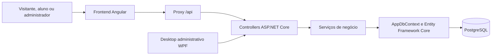
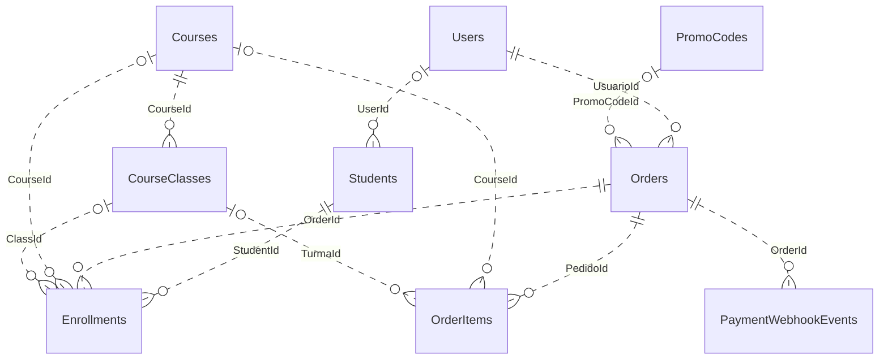

# Documentação técnica — PIM4Front / MediShop

O PIM4Front é o cliente web da plataforma MediShop, voltada à divulgação, inscrição e gestão de cursos presenciais na área da saúde. Esta documentação descreve o código atual e se integra à documentação do PIM4API, que concentra as regras de negócio e o acesso ao PostgreSQL.

## Guia de leitura

| Documento                                                 | Conteúdo                                                                                        |
| --------------------------------------------------------- | ----------------------------------------------------------------------------------------------- |
| [Arquitetura do sistema](docs/ARQUITETURA.md)             | Contexto, componentes, camadas, decisões, fluxo de compra e implantação                         |
| [Banco de dados e DER](../PIM4API/docs/BANCO-DE-DADOS.md) | Modelo relacional completo, diagramas, chaves, cardinalidades, índices e dicionário das colunas |
| [Arquitetura da API](../PIM4API/docs/ARQUITETURA.md)      | Organização do backend e responsabilidades dos serviços                                         |
| [CI/CD](docs/CI-CD.md)                                    | Pipelines, verificações, artefatos e configuração do deploy                                     |
| [Validação no Render](docs/VALIDACAO-RENDER.md)           | Homologação, erros e confirmação fictícia de pagamento                                          |
| [Requisitos acadêmicos](docs/REQUISITOS-ACADEMICOS.md)    | ML, acessibilidade, relações étnico-raciais, empreendedorismo e computação em nuvem             |
| [Execução e manutenção](README.md)                        | Comandos locais, configuração, testes e problemas comuns                                        |

Os links para PIM4API pressupõem que os dois repositórios estejam em pastas irmãs. Os arquivos históricos de auditoria mantêm a data e o contexto em que foram produzidos; os documentos acima descrevem a estrutura desta revisão.

## 1. Arquitetura definida

O sistema usa arquitetura **cliente-servidor**. O Angular é uma SPA, organizada por funcionalidades, e consome uma API REST/JSON em ASP.NET Core. A API é um monólito organizado em camadas lógicas de controllers/DTOs, serviços e persistência via EF Core. O banco é PostgreSQL.



O frontend apresenta dados, valida formulários e controla a navegação. A API valida preços, vagas, permissões, pedidos e matrículas. O banco aplica as relações e restrições persistidas. O diagrama de implantação e a descrição dos limites de cada componente estão em [Arquitetura](docs/ARQUITETURA.md).

## 2. Tecnologias e estrutura

| Tecnologia           | Uso                                                              |
| -------------------- | ---------------------------------------------------------------- |
| Angular e TypeScript | Componentes standalone, roteamento, formulários e contratos HTTP |
| RxJS e Signals       | Requisições, estado, carregamento e atualização das telas        |
| SCSS                 | Estilos globais e por componente                                 |
| Vitest / Playwright  | Testes de componentes/serviços e cenário E2E local               |
| Node.js 24           | Ambiente definido para build e CI                                |
| Nginx                | Publicação dos arquivos Angular e proxy para a API               |

As versões exatas das dependências estão em `package.json` e `package-lock.json`.

```text
src/app/
├── core/
│   ├── config/          # URL relativa /api
│   ├── guards/          # navegação autenticada e administrativa
│   ├── http/            # tradução das respostas de erro
│   ├── interceptors/    # JWT e renovação da sessão
│   ├── models/          # contratos TypeScript
│   └── services/        # HTTP, sessão, carrinho e VLibras
├── features/            # telas públicas, aluno e administração
├── shared/              # validação, acessibilidade e componentes comuns
├── app.routes.ts        # rotas e carregamento das telas
├── app.config.ts        # providers do aplicativo
└── app.html             # navegação, conteúdo e rodapé
```

`features/home` implementa o catálogo; `course-detail` apresenta curso, turmas e sugestões; `auth` trata login/cadastro; `account` reúne perfil e histórico; `cart` e `checkout` tratam a seleção e o pedido; `order-detail` mostra o pagamento; `student` e `enrollment-detail` apresentam matrículas; `admin` reúne os módulos administrativos.

## 3. Integração com a API

A configuração central é [api.config.ts](src/app/core/config/api.config.ts):

```typescript
export const API_URL = '/api';
```

O navegador usa caminhos relativos, como `/api/courses/catalog`. Durante `npm start`, `proxy.conf.json` encaminha as chamadas à API local. No container, o Nginx usa `API_UPSTREAM`, com padrão local `http://api:8080` e URL raiz HTTPS da API na hospedagem.

| Recurso             | Contratos principais                                                                                   |
| ------------------- | ------------------------------------------------------------------------------------------------------ |
| Autenticação        | `/api/Auth/cadastrar`, `/api/Auth/login`, `/api/Auth/refresh`, `/api/Auth/revoke` e `/api/Auth/perfil` |
| Catálogo            | `/api/courses/catalog`, `/api/courses/catalog/options` e `/api/courses/{id}`                           |
| Recomendações       | `/api/courses/{id}/recommendations`                                                                    |
| Turmas              | `/api/courses/{courseId}/classes` e operações administrativas vinculadas                               |
| Pedidos             | `/api/Orders`, `/api/Orders/my` e `/api/Orders/{id}`                                                   |
| Matrículas do aluno | `/api/me/courses` e `/api/me/enrollments/{id}`                                                         |
| Administração       | `/api/courses`, `/api/Students`, `/api/PromoCodes` e `/api/audit`                                      |
| Confirmação interna | `/api/payments/webhook`, com assinatura HMAC                                                           |

Os controllers são a referência dos contratos implementados. Documentos antigos e o OpenAPI alvo estático podem conter propostas de recursos; o OpenAPI gerado pela aplicação em Development representa a versão em execução.

## 4. Rotas e autorização

| Rota                        | Acesso      | Responsabilidade                             |
| --------------------------- | ----------- | -------------------------------------------- |
| `/`                         | Público     | Apresentação                                 |
| `/catalogo`                 | Público     | Busca e filtros de cursos                    |
| `/curso/:id`                | Público     | Curso, seleção de turma e recomendações      |
| `/login`                    | Público     | Login e cadastro                             |
| `/carrinho`                 | Público     | Seleção persistida localmente                |
| `/checkout`                 | Autenticado | Criação do pedido                            |
| `/conta`                    | Autenticado | Perfil e histórico                           |
| `/conta/pedido/:id`         | Autenticado | Detalhes e atualização da situação do pedido |
| `/area-aluno`               | Autenticado | Matrículas                                   |
| `/area-aluno/matricula/:id` | Autenticado | Detalhes e recursos da matrícula             |
| `/admin`                    | Admin       | Gestão administrativa                        |

`authGuard` e `adminGuard` controlam a navegação. A API exige JWT, role e vínculo do recurso com o usuário conforme a operação. O cadastro público cria uma conta Cliente. A rota antiga `/conta/matricula/:id` redireciona para a área do aluno; caminhos desconhecidos redirecionam para a página inicial.

O `AuthService` guarda access token, refresh token e os dados retornados do usuário no Local Storage. O interceptor envia o JWT em chamadas da API e compartilha o refresh quando há requisições simultâneas. Uma renovação recusada encerra a sessão local e encaminha ao login com a página de retorno; falhas transitórias possuem mensagens próprias. O logout chama a revogação da sessão correspondente e limpa os dados locais.

## 5. Modelo de dados e DER resumido

Os tipos em `core/models` são contratos de transporte. O modelo físico, as FKs e as migrations são definidos no PIM4API. O núcleo relaciona contas, alunos, cursos, turmas, pedidos, itens e matrículas:



Cada pedido pertence a uma conta e reúne itens. A matrícula identifica o aluno, o pedido e, quando presentes, curso e turma. O evento de pagamento se vincula ao pedido. Referências opcionais aparecem com `|o`; `o{` representa zero ou muitos registros dependentes.

Consulte [Banco de dados e DER](../PIM4API/docs/BANCO-DE-DADOS.md) para o modelo completo, incluindo autenticação, auditoria, interesses, conteúdo educacional e regras físicas de exclusão. Campos legados de apresentação não devem ser interpretados como FKs apenas pelo nome.

## 6. Compra, pagamento e matrícula

O usuário escolhe curso e turma, adiciona ao carrinho e cria o pedido. O frontend envia IDs, quantidade, forma de pagamento, parcelas e cupom. O backend consulta os valores válidos e reserva as vagas dentro da transação.

As formas de pagamento usadas no contrato são `pix`, `credit_card` e `debit_card`. Há limite de uma vaga por curso para o próprio aluno, com possibilidade de vários cursos diferentes no mesmo pedido.

Após a criação, o site abre os detalhes do pedido, que aguarda confirmação. Pedido pendente não concede matrícula. O webhook interno assinado processa o evento e gera a matrícula conforme as regras de estado/idempotência. A integração com cobrança e estorno de um provedor real continua pendente.

Em falhas, o carrinho é preservado. Reenvios do mesmo pedido na mesma instância da tela reutilizam a chave de idempotência. Mudanças no pedido geram uma nova chave. A tela permite conferir o histórico e atualizar a situação do pagamento.

## 7. Recomendações e acessibilidade

A seção “Cursos semelhantes” consulta a API. O recomendador usa ML.NET/K-Means com os textos públicos do catálogo. Falhas ou listas vazias recebem uma explicação e não impedem consultar o curso. O modelo, seus limites e a avaliação de relevância estão documentados em [Requisitos acadêmicos](docs/REQUISITOS-ACADEMICOS.md) e [ML na API](../PIM4API/docs/MACHINE-LEARNING.md).

O rodapé oferece a ativação do serviço externo VLibras. O aplicativo também possui indicadores de foco, rótulos, mensagens de validação e link para pular ao conteúdo principal. A inclusão desses recursos precisa ser complementada por avaliação de teclado, leitor de tela, contraste e tradução efetiva.

## 8. Persistência no navegador

| Informação        | Armazenamento                             |
| ----------------- | ----------------------------------------- |
| Access token      | `medishop_token` no Local Storage         |
| Refresh token     | `medishop_refresh_token` no Local Storage |
| Usuário da sessão | `medishop_user` no Local Storage          |
| Carrinho          | `pim4_courses_cart_v2` no Local Storage   |

Pedidos, matrículas, pagamentos, vagas e cupons têm como fonte a API e o PostgreSQL. A seleção no navegador não comprova reserva nem pagamento. Segredos do banco, JWT do servidor e webhook pertencem ao ambiente da API.

## 9. Execução, testes e publicação

Na pasta do frontend, com as dependências definidas no lockfile:

```bash
npm ci
npm start
npm run test:ci
npm run build
```

O CI verifica formatação, testes, build, dependências e a imagem Docker. O E2E completo usa o ambiente local descrito em [e2e/README.md](e2e/README.md). Um build aprovado não comprova o funcionamento de todas as integrações hospedadas; a homologação segue o [roteiro do Render](docs/VALIDACAO-RENDER.md).

Migrations, backup e conexão do banco estão no PIM4API. As instruções completas de operação ficam nos READMEs dos repositórios e no [guia de CI/CD](docs/CI-CD.md).

## 10. Escopo e próximas entregas

O fluxo comercial habilitado é de cursos presenciais. Há estruturas e código de módulos, aulas, progresso, avaliações e certificados EAD, cuja oferta comercial está desabilitada nesta versão.

As próximas entregas incluem integração e homologação do pagamento real, e-mail e recuperação de senha, operação de backup/monitoramento na hospedagem e validação dos clientes desktop/mobile nos ambientes correspondentes. A documentação acadêmica registra propostas e evidências sem apresentar funcionalidades futuras como concluídas.
