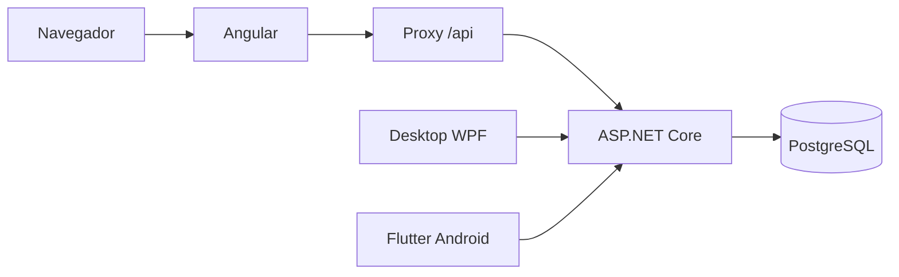

# PIM4Front — Plataforma de cursos

Site da plataforma MediShop em Angular. Reúne catálogo de cursos presenciais, seleção de turmas, carrinho, pedidos, área do aluno e administração. Consome o **PIM4API**; o navegador não acessa o banco diretamente.

**Atualizado em 12/10/2026.** O ambiente local está implementado. Pagamento real e publicação online estão pendentes. A falha intermitente do E2E ao verificar a turma foi identificada e corrigida.

## Índice

- [Arquitetura e projetos](#arquitetura-e-projetos)
- [Funcionalidades e regras](#funcionalidades-e-regras)
- [Tecnologias e requisitos](#tecnologias-e-requisitos)
- [Executar localmente](#executar-localmente)
- [Rotas](#rotas)
- [Estrutura](#estrutura)
- [Testes](#testes)
- [Build e publicação](#build-e-publicação)
- [Problemas comuns](#problemas-comuns)
- [Pendências](#pendências)

## Arquitetura e projetos

Organização esperada:

```text
D:\Projetos\
├── PIM4Front\     # Este site Angular
├── PIM4API\       # API, banco e Docker Compose
├── PIM4Desktop\   # Administrativo Windows/WPF
└── PIM4Mobile\    # Aplicativo Flutter Android do aluno
```

Front e API precisam ser pastas irmãs para o Compose atual. Os caminhos acima são exemplos locais; o deploy não deve depender de caminhos do Windows.



A configuração central está em [api.config.ts](src/app/core/config/api.config.ts): `API_URL = '/api'`.

| Execução          | Como chega à API                                             |
| ----------------- | ------------------------------------------------------------ |
| `npm start`       | [proxy.conf.json](proxy.conf.json) → `http://localhost:5278` |
| Docker            | [nginx.conf](nginx.conf) → `http://api:8080`                 |
| Hospedagem online | Encaminhamento/configuração ainda precisa ser definido       |

O contexto completo está em [FLUXO-DE-DESENVOLVIMENTO.md](../PIM4API/FLUXO-DE-DESENVOLVIMENTO.md). Esse arquivo também contém decisões históricas substituídas por registros posteriores. Este README descreve a configuração atual.

## Funcionalidades e regras

| Área       | Recursos atuais                                                |
| ---------- | -------------------------------------------------------------- |
| Público    | Página inicial, catálogo com busca/filtros e detalhes do curso |
| Inscrições | Seleção de turma, consulta de vagas e carrinho                 |
| Conta      | Cadastro, login, perfil e histórico de pedidos                 |
| Checkout   | Criação de pedido, forma de pagamento e cupom                  |
| Aluno      | Matrículas, busca/filtro e informações da turma                |
| Admin      | Cursos, turmas, alunos, cupons, pedidos, dashboard e auditoria |

- Cursos usam `Courses`; `Products` foi removido.
- Turmas se vinculam a cursos por `CourseClasses.CourseId`.
- Uma turma disponível precisa estar agendada, ter vagas e começar no futuro. As inscrições encerram no **horário de início**, inclusive no mesmo dia.
- Pedido pendente não libera matrícula; o acesso depende da confirmação pela API.
- Detalhes da matrícula usam o **ID da matrícula**, não o ID do curso.
- A criação de cursos no admin está limitada à modalidade presencial. Há código de EAD, progresso e avaliações, mas ele não representa uma oferta EAD atualmente habilitada.
- As opções Pix, débito e crédito no checkout ainda não fazem cobrança integrada a um provedor externo.

## Tecnologias e requisitos

| Tecnologia                    | Uso                    |
| ----------------------------- | ---------------------- |
| Angular 21.2 / TypeScript 5.9 | Aplicação e roteamento |
| SCSS                          | Estilos                |
| RxJS / Signals                | HTTP e estado          |
| lucide-angular                | Ícones                 |
| Vitest                        | Testes do frontend     |
| Playwright                    | E2E local              |
| Node.js 24 / Nginx 1.29       | Imagens do Dockerfile  |

Para desenvolver fora do container, utilize Node.js 24 e npm. Para rodar tudo em containers, utilize Docker com Compose e containers Linux; no Windows, Docker Desktop com WSL 2.

O E2E atual usa PowerShell e Chrome instalado e roda fora do container. As versões de dependências estão em [package.json](package.json) e [package-lock.json](package-lock.json).

## Executar localmente

### Opção A — Tudo no Docker

Configure o `.env` conforme o [README da API](../PIM4API/README.md). Na pasta PIM4API:

```powershell
cd D:\Projetos\PIM4API
docker compose up -d --build
docker compose ps
```

| Serviço      | Endereço padrão              |
| ------------ | ---------------------------- |
| Site         | http://localhost:4200        |
| API          | http://localhost:5278/api    |
| Saúde da API | http://localhost:5278/health |
| PostgreSQL   | localhost:5432               |

Após alterar o frontend, com API e banco já ativos:

```powershell
docker compose up -d --build --no-deps frontend
```

### Opção B — Frontend com atualização automática

Na pasta PIM4API, mantenha banco e API ativos e libere a porta do site:

```powershell
cd D:\Projetos\PIM4API
docker compose up -d --build postgres api
docker compose stop frontend
```

Em outro terminal:

```powershell
cd D:\Projetos\PIM4Front
npm ci
npm start
```

Abra `http://localhost:4200`. O proxy já está configurado em [angular.json](angular.json).

Para desenvolver na porta 4201, mantendo o container na 4200:

```powershell
npm start -- --host 127.0.0.1 --port 4201
```

Se a porta da API mudar, ajuste `target` em `proxy.conf.json`. Chaves JWT, senhas do banco e segredos de pagamento pertencem à API e nunca devem ir para o bundle Angular.

## Rotas

| Rota                        | Acesso        | Finalidade                    |
| --------------------------- | ------------- | ----------------------------- |
| `/`                         | Público       | Página inicial                |
| `/catalogo`                 | Público       | Catálogo                      |
| `/curso/:id`                | Público       | Detalhes pelo ID do curso     |
| `/login`                    | Público       | Login e cadastro              |
| `/carrinho`                 | Público       | Carrinho                      |
| `/checkout`                 | Autenticado   | Criar pedido                  |
| `/conta`                    | Autenticado   | Perfil e pedidos              |
| `/conta/pedido/:id`         | Autenticado   | Pedido                        |
| `/area-aluno`               | Autenticado   | Matrículas                    |
| `/area-aluno/matricula/:id` | Autenticado   | Detalhes pelo ID da matrícula |
| `/admin`                    | Administrador | Painel administrativo         |

`/conta/matricula/:id` redireciona para `/area-aluno/matricula/:id`. Guards auxiliam a navegação; a autorização efetiva e a propriedade dos dados são verificadas pela API.

## Estrutura

```text
src/app/
├── core/
│   ├── config/          # URL da API
│   ├── guards/          # Sessão e acesso administrativo
│   ├── interceptors/    # Autenticação nas chamadas
│   ├── models/          # Contratos TypeScript
│   └── services/        # HTTP e estado compartilhado
├── features/
│   ├── admin/           # Painel e componentes administrativos
│   ├── auth/            # Login e cadastro
│   ├── landing/         # Página inicial
│   ├── home/            # Catálogo
│   ├── course-detail/   # Curso e escolha de turma
│   ├── cart/            # Carrinho
│   ├── checkout/        # Pedido
│   ├── account/         # Conta e histórico
│   ├── order-detail/    # Detalhes do pedido
│   ├── student/         # Área do aluno
│   └── enrollment-detail/ # Detalhes da matrícula
└── app.routes.ts
e2e/                     # Cenário Playwright
scripts/                 # Inicialização do E2E
```

O admin compartilha estilos em `admin.scss` e `admin-layout.scss`. Botões de navegação e estilos globais estão em `src/styles.scss`.

## Testes

### Testes do frontend

```powershell
npm test -- --watch=false
```

Para observar mudanças: `npm test`. A última execução registrada em 09/10/2026 aprovou 45 testes; isso não substitui uma nova execução após alterações.

### E2E local

Com o ambiente ativo, Chrome instalado e um administrador local:

```powershell
npm run test:e2e
npm run test:e2e -- -Headed
npm run test:e2e:report
```

O primeiro comando solicita credenciais e executa sem janela; `-Headed` permite acompanhar o navegador. O script lê o segredo do webhook no `.env` do PIM4API.

**Situação em 12/10/2026:** o travamento era uma falha de estado do admin: a consulta inicial atrasada sobrescrevia o curso/turma recém-cadastrados. A resposta agora preserva os dados mais recentes e incorpora cursos existentes ainda não carregados. O cenário com atraso controlado usa a resposta real da API; não substitui seus dados.

O teste cria curso, turma, aluno, pedido e matrícula fictícios no banco local. Arquiva o curso `TESTE E2E` no bloco de finalização e preserva o histórico. Interromper o processo pode impedir esse arquivamento. Não movimenta dinheiro e rejeita endereços externos.

Parâmetros e cobertura: [e2e/README.md](e2e/README.md). Confirmação manual alternativa: [README da API](../PIM4API/README.md#pagamento-de-teste-e-webhook-local).

## Build e publicação

```powershell
npm run build
```

Arquivos para hospedagem estática: `dist/frontend/browser/`. O Dockerfile faz o build e os serve pelo Nginx.

A hospedagem precisa servir HTTPS, retornar `index.html` para rotas Angular e encaminhar `/api/` para a API publicada. Se a API ficar em outro domínio, será necessária uma adaptação explícita da configuração e das origens CORS.

O nome Docker `api` do Nginx atual não funciona automaticamente em hospedagem estática ou serviços separados. O `render.yaml` do PIM4API prepara API e banco, **não publica este frontend**.

Há avisos conhecidos de orçamento SCSS. Confira o código de saída do build e resolva qualquer limite de erro antes de publicar.

## Problemas comuns

| Sintoma                        | Verificação                                                                                         |
| ------------------------------ | --------------------------------------------------------------------------------------------------- |
| Falha em `/api`                | API ativa e destino/porta do proxy                                                                  |
| Porta 4200 ocupada             | Container e `npm start` na mesma porta                                                              |
| Curso sem compra               | Curso ativo; turma futura, agendada e com vagas                                                     |
| Matrícula ausente              | Pagamento confirmado, reserva não expirada e conta correta                                          |
| Admin não abre                 | Role `Admin`; cadastro público cria `Cliente`                                                       |
| Carrinho antigo                | Remontar após a migração Products → Courses                                                         |
| Mudança não aparece no Docker  | Reconstruir o frontend e recarregar                                                                 |
| Rota direta retorna 404 online | Fallback para `index.html`                                                                          |
| HTTP 429 no cadastro/login     | Aguardar a janela do limite da API                                                                  |
| E2E falha                      | Conferir a última etapa [E2E] no terminal e o relatório; HTTP 429 exige aguardar a janela do limite |

## Pendências

- Integrar e validar o pagamento real.
- Publicar frontend/API/banco e repetir os fluxos online.
- Configurar operação, backups e validar compras concorrentes.
- Finalizar distribuição/testes do desktop contra a API publicada.
- Validar a primeira versão Flutter Android no aparelho e preparar distribuição.
- Lembretes aos alunos perto do início do curso: melhoria futura.

Banco, autenticação, migrations e hospedagem: [README do PIM4API](../PIM4API/README.md).

## Revisão completa — 17/10/2026

[Relatório dos quatro projetos](../PIM4API/docs/AUDITORIA-COMPLETA-2026-10-17.md): funcionalidades, tecnologias, banco, testes, riscos encontrados e etapas para publicação.

## Correções — 24/10/2026

[Registro das correções](../PIM4API/docs/CORRECOES-AUDITORIA-2026-10-24.md): vagas/transações, uma vaga por curso, sessão, dependências, backup e configuração de publicação. Pagamento externo permanece pendente.

## Code formatting

Prettier formats the frontend source, Angular templates, styles, configuration and documentation.

- Run `npm run format` (equivalent to `npx prettier --write .`) to format the project.
- Run `npm run format:check` to verify formatting without modifying files; CI runs this check.
- The workspace recommends the Prettier extension and enables format on save for supported file types.
- Generated output, dependencies, secrets and the npm lockfile are excluded in `.prettierignore`.
- Formatting uses two spaces, LF line endings and the Angular parser for HTML. PowerShell and Nginx files are not formatted by Prettier.
