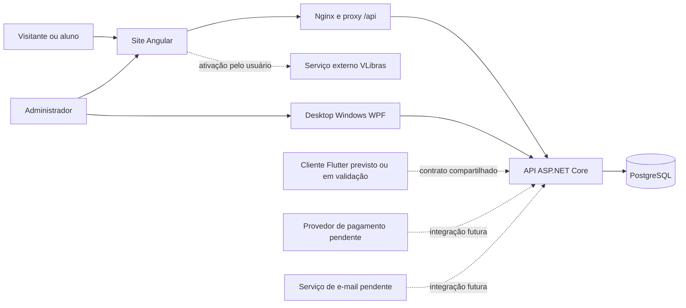
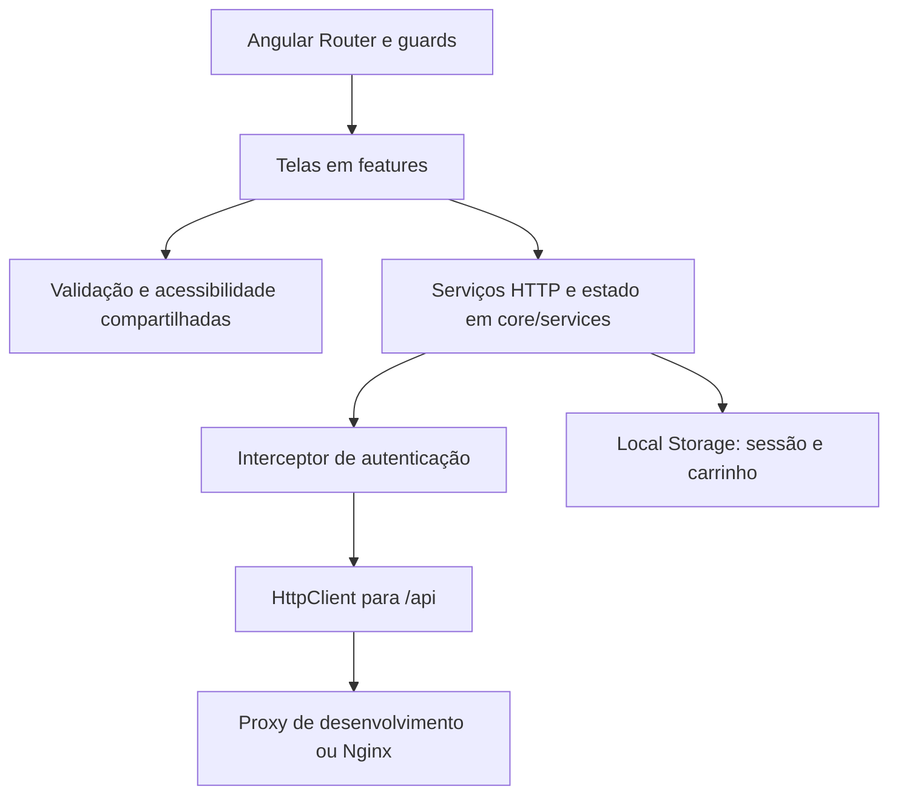
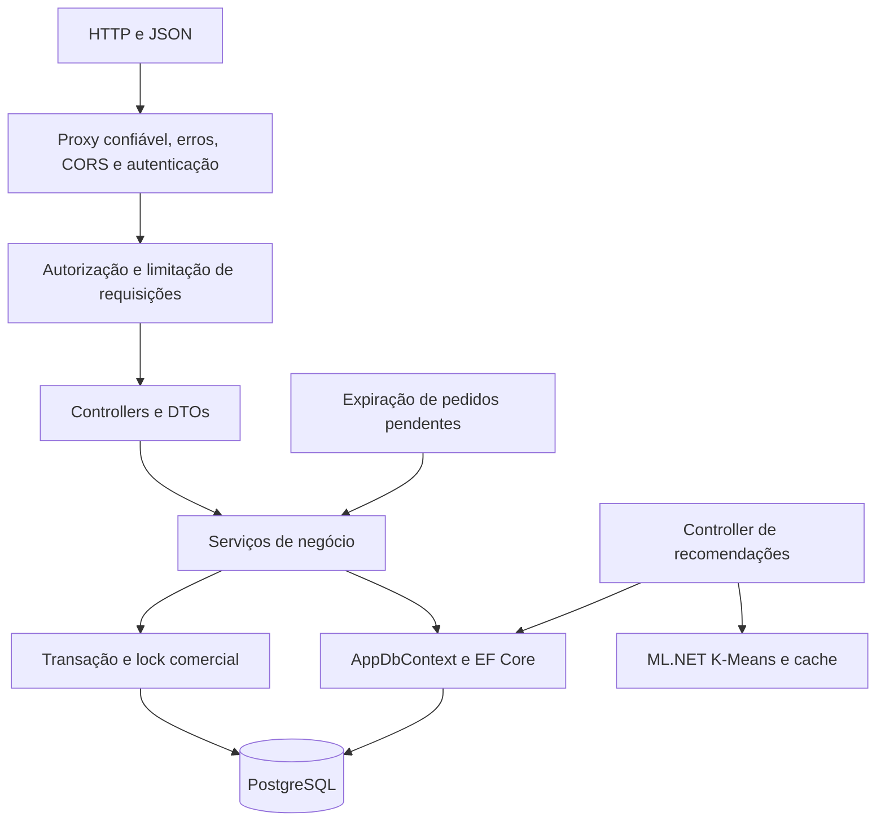
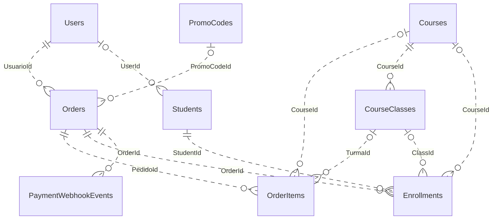
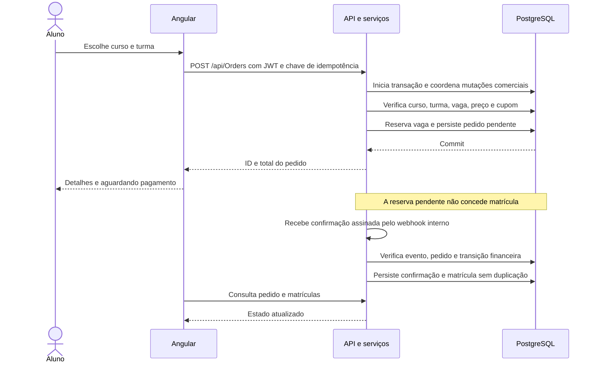
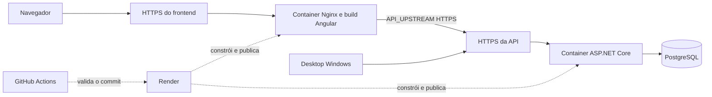

# Arquitetura do PIM4 — MediShop

Referência: código dos repositórios locais PIM4Front e PIM4API nesta revisão. Os diagramas descrevem a implementação; não comprovam a configuração efetiva do ambiente hospedado.

## 1. Visão e decisões arquiteturais

O sistema adota arquitetura **cliente-servidor**, com uma API central de negócio e persistência relacional. O frontend é uma aplicação Angular de página única (SPA). A API é uma aplicação ASP.NET Core organizada em camadas lógicas de controllers, serviços, entidades e acesso a dados com Entity Framework Core.

A API é um monólito de negócio implantável em um container. Frontend, API e banco possuem responsabilidades e processos distintos. Os controllers, serviços e entidades da API estão no mesmo projeto .NET; não há projetos separados de Domain/Application/Infrastructure ou uma camada de repositories própria. Os serviços utilizam o `AppDbContext` diretamente.

| Decisão              | Aplicação e motivo                                                                          |
| -------------------- | ------------------------------------------------------------------------------------------- |
| API central          | Compartilhar autenticação, regras de cursos, pedidos, vagas e matrículas entre clientes     |
| SPA Angular          | Navegação no navegador, formulários, estado da sessão/carrinho e apresentação das respostas |
| PostgreSQL + EF Core | Persistência relacional, FKs, índices, migrations e transações                              |
| Nginx no frontend    | Servir o build e encaminhar `/api` ao serviço da API                                        |
| JWT + refresh token  | Autenticar chamadas e permitir renovação da sessão                                          |
| Containers           | Definir o ambiente de execução do frontend e da API                                         |
| ML.NET na API        | Recomendar cursos por conteúdo, com cache em memória e sem serviço adicional de ML          |

## 2. Contexto do sistema

O desktop WPF existente usa HTTP/HTTPS e JWT para consultas administrativas e autenticação. Sua URL é configurável, e a validação contra o ambiente de produção no Windows permanece uma etapa própria. O mobile não está disponível nesta instalação e não foi inspecionado nesta revisão; seu papel aparece como contexto de evolução.

O navegador e o desktop acessam a API. A conexão PostgreSQL e os segredos do servidor ficam no backend. O VLibras é uma integração do navegador, ativada no rodapé, e não uma tabela ou serviço interno da API.

## 3. Componentes do frontend

| Diretório/componente | Responsabilidade                                                                         |
| -------------------- | ---------------------------------------------------------------------------------------- |
| `src/app/features`   | Catálogo, detalhes, autenticação, conta, carrinho, checkout, matrículas e administrativo |
| `core/models`        | Contratos TypeScript das requisições/respostas, sem mapeamento direto de tabelas         |
| `core/services`      | Chamadas HTTP, sessão, carrinho e carregamento do VLibras                                |
| `core/interceptors`  | Inclusão do access token e tratamento da renovação de sessão                             |
| `core/guards`        | Controle de navegação autenticada e administrativa                                       |
| `core/http`          | Mensagens de erro de conexão, autorização e regras retornadas pela API                   |
| `shared`             | Validadores de formulários, mensagens e controles de acessibilidade                      |

Guards melhoram a navegação, e a API aplica a autorização efetiva. O `AuthService` mantém a sessão no Local Storage e coordena uma renovação compartilhada para evitar refresh simultâneo. O carrinho guarda a seleção local; preços, vagas, cupom e permissão de compra são verificados novamente pela API.

## 4. Componentes da API

Grupos principais de serviços:

- `AuthService` e `TokenService`: cadastro, perfil, senha, sessão e JWT.
- `CourseService`, `StudentService` e `EnrollmentStateService`: cursos, turmas, alunos e alterações de matrícula/vagas.
- `OrderService`, `InventoryService`, `PromoCodeService` e `EnrollmentService`: pedido, reserva, cupom, confirmação e matrícula.
- `PendingOrderExpirationService`: encerra reservas pendentes vencidas em segundo plano.
- `ParticipationService`: regras de confirmação de participação.
- `AuditService`: registro das alterações administrativas/comerciais.
- `CourseRecommendationEngine`: vetorização TF-IDF, K-Means, cache do catálogo e ordenação das sugestões.

As respostas podem ser dados ou erros de negócio em JSON. Os DTOs públicos limitam o que é enviado aos clientes; hashes de senha e tokens persistidos não fazem parte do catálogo ou das recomendações.

## 5. Banco e DER

O PostgreSQL contém os dados de conta, catálogo, pedidos, matrículas, auditoria e estruturas de conteúdo educacional. O [dicionário completo do banco e DER](../../PIM4API/docs/BANCO-DE-DADOS.md) documenta tabelas, colunas, chaves, cardinalidades, exclusões e índices do modelo EF Core, com diagramas por domínio.

Visão resumida do núcleo comercial:

`||` indica uma referência obrigatória, `|o` uma referência opcional e `o{` zero ou muitos registros dependentes. As relações acima são FKs; regras de negócio podem restringir operações além das cardinalidades físicas. Os campos opcionais de curso/turma preservam compatibilidade e histórico.

Os nomes `Students.CourseId` e `CourseProgresses.CourseId` exigem atenção: o primeiro é texto legado de apresentação; o segundo é uma associação usada pela aplicação sem FK de curso no modelo atual. O DER físico completo destaca essas diferenças. O cadastro de usuário e o cadastro de aluno também são entidades distintas, com `Students.UserId` opcional e sem índice único.

O ML usa metadados já existentes em `Courses` e `CourseClasses`; não cria uma tabela de modelo. O cache de recomendações e o carrinho do navegador não fazem parte do DER relacional.

## 6. Fluxo de pedido e matrícula

A assinatura atual é um contrato interno de teste. O provedor externo de pagamento e seus eventos ainda precisam ser integrados. A expiração encerra pedidos pendentes vencidos e libera reservas; confirmação tardia pode exigir conciliação.

As mutações comerciais usam transação e `pg_advisory_xact_lock` no PostgreSQL. O lock coordena operações de vagas, pedidos e cupons entre instâncias ligadas ao mesmo banco. Ele reduz o paralelismo de escrita e deve envolver operações curtas; chamadas a gateways externos precisam de um desenho de integração próprio.

## 7. Execução local e implantação

| Ambiente                | Comunicação                                                                                                 |
| ----------------------- | ----------------------------------------------------------------------------------------------------------- |
| Angular com `npm start` | Navegador chama `/api`; `proxy.conf.json` encaminha à API local                                             |
| Docker Compose          | Nginx serve o frontend e usa `API_UPSTREAM=http://api:8080`; API acessa `postgres` na rede Docker           |
| Render                  | Frontend usa a raiz HTTPS da API em `API_UPSTREAM`; API recebe conexão e segredos por variáveis de ambiente |
| Desktop                 | `Api:BaseUrl` ou `PIM4_API_BASE_URL` aponta à raiz da API; o cliente compõe `/api`                          |

O Compose local e os Blueprints estão no PIM4API/PIM4Front. A infraestrutura hospedada deve ser conferida no painel; frontend e API têm deploys independentes. O [guia de CI/CD](CI-CD.md) registra checks, artefatos e configuração de deploy condicionado.

## 8. Estado e limites do escopo

O foco comercial atual é curso presencial. Módulos, aulas, progresso, avaliações e certificados EAD possuem código e tabelas, mas a criação de ofertas EAD está desabilitada no fluxo atual. A presença dessas tabelas não representa uma oferta EAD homologada.

Pagamento externo, e-mail/recuperação de senha, rotina de backup da hospedagem e homologação dos clientes fora do navegador continuam etapas próprias. A operação do VLibras depende de um serviço externo. O desktop atual foi inspecionado como cliente HTTP; testes de produção no Windows e o mobile não foram homologados nesta revisão.

## Fontes da arquitetura

- Frontend: `app.routes.ts`, `core`, `features`, `shared`, `proxy.conf.json`, `Dockerfile` e `nginx.conf`.
- API: `Program.cs`, `Controllers`, `Services`, `Models`, `Data/AppDbContext.cs` e migrations.
- Banco: metadados do EF Core exportados sem conexão com produção, confrontados com o snapshot das migrations.
- Infraestrutura: `docker-compose.yml`, `render.yaml` e `.github/workflows` dos repositórios.
