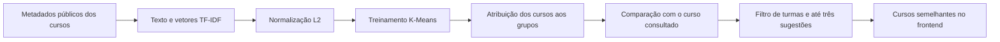

# PIM4 — Integração dos temas do semestre

Este documento relaciona o projeto MediShop aos temas de Machine Learning, acessibilidade, relações étnico-raciais e afrodescendência, empreendedorismo em TI, Cloud Computing e DevOps. É um texto de apoio ao relatório acadêmico; a rubrica e a aceitação final devem ser conferidas com o professor.

As descrições distinguem código implementado, validação técnica e propostas de evolução. Resultados de testes não representam pesquisa com usuários, validação pedagógica ou certificação de acessibilidade.

## Matriz de atendimento e evidências

| Tema                                       | Aplicação no projeto                                                                                         | Evidência                                                                                          | Situação                                                                                     |
| ------------------------------------------ | ------------------------------------------------------------------------------------------------------------ | -------------------------------------------------------------------------------------------------- | -------------------------------------------------------------------------------------------- |
| Machine Learning                           | Agrupamento de cursos e sugestões por conteúdo                                                               | ML.NET, treinamento K-Means e endpoint de recomendações na API; seção “Cursos semelhantes” no site | Implementado e testado localmente; homologação no Render pendente                            |
| Acessibilidade                             | Tradução em Libras ativada pelo usuário, navegação por teclado e mensagens dos formulários                   | VLibras no rodapé, link para pular ao conteúdo e testes de falha do carregamento                   | Integração implementada; tradução real e avaliação com usuários pendentes                    |
| Relações étnico-raciais e afrodescendência | Discussão de acesso à qualificação, representatividade, enfrentamento do racismo e limites das recomendações | Seção temática deste documento e critérios de revisão de conteúdo                                  | Fundamentação e proposta de aplicação; não constitui ação social já executada                |
| Empreendedorismo em TI                     | Plataforma digital para comercialização e gestão de cursos presenciais de saúde                              | Catálogo, turmas, pedidos, cupons, matrículas e administração                                      | Fluxos do protótipo existentes; hipóteses de negócio ainda não validadas comercialmente      |
| Cloud Computing                            | Frontend/API em containers, banco PostgreSQL e configuração de hospedagem                                    | Dockerfiles e `render.yaml` de ambos os repositórios                                               | Configuração versionada; ambiente no Render informado pelo responsável                       |
| DevOps                                     | Verificações automáticas e preparação para deploy após aprovação                                             | CI, testes, auditoria, CodeQL, Dependabot e artefatos                                              | Configuração versionada; execuções e regras remotas precisam ser conferidas no GitHub/Render |

## 1. Machine Learning: cursos semelhantes

### Problema e escolha do algoritmo

O usuário pode encontrar dificuldade para identificar formações relacionadas a um curso de interesse. A solução implementada é um recomendador baseado no conteúdo público dos cursos, usando a biblioteca **Microsoft.ML 5.0.1 (ML.NET)** e o algoritmo de agrupamento **K-Means**.

K-Means é um algoritmo de aprendizado não supervisionado: encontra agrupamentos nos vetores dos dados sem precisar de rótulos de resposta fornecidos por professores ou alunos. O projeto utiliza a preparação de texto TF-IDF e a normalização L2 antes de treinar os grupos. A descrição dessa tarefa segue o [tutorial oficial de clustering do ML.NET](https://learn.microsoft.com/en-us/dotnet/machine-learning/tutorials/iris-clustering).

### Por que “mais vendidos” não basta

Um ranking que soma inscrições de pedidos pagos e ordena os cursos é uma agregação estatística. Ele pode ser útil como indicador comercial ou referência de comparação, mas não treina um modelo. O ranking de vendas não foi apresentado como evidência de ML e não foi incluído como funcionalidade nesta etapa.

Em eventual implementação desse ranking, considerar somente pedidos confirmados, excluir estados cancelados/recusados/reembolsados conforme a regra de negócio e definir o período da análise. Não confundir quantidade de pedidos com quantidade de vagas vendidas.

### Dados e processamento implementados

O conjunto de treinamento é formado por cursos presenciais ativos, limitados aos primeiros 200 IDs em ordem crescente nesta versão de demonstração. A identificação serve para associar o resultado ao catálogo; o vetor usa nome, categoria e descrição, com limites de 120, 120 e 2.000 caracteres. O vocabulário é limitado a 2.048 termos.

Não são usados CPF, raça/cor, origem étnica, e-mail, telefone, preço, compras pessoais ou características dos alunos como atributos de treinamento. Preço e imagem são apenas dados de apresentação do resultado.

Fluxo implementado:



O treinamento exige pelo menos quatro cursos e dois textos distintos. O número de grupos varia entre dois e três conforme o tamanho e a diversidade textual do catálogo. A semente de treinamento é 42.

As sugestões priorizam o mesmo grupo e depois a similaridade de cosseno dos vetores. O curso atual é excluído. Cursos sugeridos precisam ter turma futura, agendada e com vagas; cursos arquivados e EAD ficam fora deste conjunto. Similaridades inferiores a 0,05 são descartadas. Esses parâmetros são escolhas iniciais do protótipo, ainda sujeitos à avaliação de relevância.

O cache em memória guarda as representações e os grupos do catálogo atual. Mudanças no texto ou na composição do conjunto provocam novo treinamento; disponibilidade e preço são verificados com os dados atuais e não provocam treinamento por si só. Reiniciar a API elimina o cache. Esta versão não persiste um arquivo de modelo nem mantém um serviço Python separado.

### Contrato e evidências técnicas

Endpoint público:

```text
GET /api/courses/{id}/recommendations
```

A resposta contém `status`, `algorithm`, `modelVersion`, `trainedAt`, `trainingCourseCount`, `clusterCount` e `items`. Quando não há sugestões, `emptyReason` distingue falta de candidatos com turmas disponíveis de falta de similaridade; `eligibleCourseCount` registra quantos outros cursos disponíveis foram avaliados. O frontend exibe um estado vazio explícito, pois `ready` não garante uma lista preenchida. `modelVersion` identifica o conjunto de entrada por um resumo de hash; não é nota de qualidade do modelo. A similaridade também não é uma probabilidade de compra ou medida de qualidade pedagógica.

Estados previstos: `ready`, `insufficient-data`, `source-unavailable` e `model-unavailable`. Sem dados suficientes, não são inventadas sugestões. Uma falha no recomendador não impede consultar o curso ou comprar uma vaga.

Arquivos principais:

- API: `backend/Services/CourseRecommendationEngine.cs` e `backend/Controllers/CourseRecommendationsController.cs`.
- Testes da API: `CourseRecommendationTests.cs` e `CourseRecommendationEndpointTests.cs`.
- Frontend: `features/course-detail`, modelos e serviço de cursos.

Os testes verificam agrupamento e ordenação em um catálogo sintético pequeno, atualização do modelo após alteração do texto, filtro de disponibilidade, exclusão de cursos arquivados/EAD e comportamento sem dados suficientes. Esses testes não medem a qualidade em um catálogo real.

### Roteiro para apresentação e avaliação

1. Ter pelo menos quatro cursos presenciais ativos, com textos descritivos e temas variados; preparar turmas futuras com vagas para os candidatos.
2. Consultar o endpoint e registrar algoritmo, quantidade de cursos, grupos e versão do conjunto.
3. Abrir os detalhes de um curso e mostrar as sugestões; seguir um link e verificar o novo curso.
4. Alterar um texto do catálogo e mostrar a nova versão do conjunto após uma consulta.
5. Fechar as vagas de um candidato e verificar que ele deixa de ser sugerido.
6. Apresentar os testes automatizados e explicar por que a função envolve treinamento, ao contrário do ranking de vendas.

Para avaliar relevância, ainda é necessário montar uma amostra com julgamento de professores/instrutores: para cada curso, indicar quais alternativas são relacionadas, comparar os três resultados com essa referência e com uma regra simples de mesma categoria, e registrar acertos e erros. Não foram medidos precisão@3, ganho comercial ou satisfação de usuários. Não há divisão treino/teste supervisionada nesta implementação de agrupamento do próprio catálogo.

### Limitações e cuidados

O método identifica proximidade textual; não compreende a qualidade do ensino nem necessidades clínicas ou profissionais individuais. Textos pouco descritivos, vocabulário inconsistente e categorias desbalanceadas podem gerar resultados ruins ou nenhuma sugestão. O limite de 200 cursos precisa ser revisto antes de aumentar o catálogo. Conteúdo não indexado pode receber `source-unavailable`.

Evitar interpretar a posição na lista como superioridade de um professor ou instituição. Revisar os resultados com pessoas que conheçam o conteúdo e manter o catálogo navegável independentemente das sugestões.

## 2. Acessibilidade e VLibras

O projeto disponibiliza o botão **Ativar tradução em Libras** no rodapé. Após a ação do usuário, o navegador carrega o script oficial do VLibras. O carregamento é compartilhado para evitar duplicação, tem limite de espera e oferece nova tentativa em falha de conexão. A integração segue o [manual oficial do Widget](https://vlibras.gov.br/doc/widget/installation/webpageintegration.html).

O código usa a inicialização automática descrita na documentação atual; não instancia um segundo widget manualmente. O recurso depende da disponibilidade do serviço externo. A ativação e o carregamento do script foram testados com eventos simulados; a tradução efetiva deve ser conferida no navegador com acesso ao provedor.

Outros recursos presentes incluem campos com rótulos, mensagens de validação próximas aos campos, estados de carregamento, indicadores de foco e link **Pular para o conteúdo principal**. Esses recursos complementam o VLibras, que não substitui leitura por tecnologia assistiva, contraste adequado, navegação por teclado ou revisão de texto.

Na homologação, verificar teclado e ordem do foco, leitor de tela, zoom, contraste, formulários, modais e sobreposição do widget em telas pequenas. Avaliação com pessoas surdas e usuários de outras tecnologias assistivas permanece necessária. Não se declara conformidade integral com WCAG ou certificação apenas por incluir o plugin.

O widget é um script externo com acesso à página. Para a apresentação, usar dados fictícios e conteúdo público do catálogo; não demonstrar a tradução selecionando dados pessoais, senhas ou tokens. Uma implantação real exige revisar também o comportamento e o tratamento de dados do fornecedor.

## 3. Relações étnico-raciais e afrodescendência

Uma plataforma de qualificação profissional pode contribuir para ampliar oportunidades de formação, mas a existência do site não comprova redução de desigualdade racial. O tratamento acadêmico deve discutir as barreiras de acesso, a representatividade e os mecanismos de enfrentamento do racismo, relacionando esses temas à educação e à área da saúde atendida pelo projeto.

As [Diretrizes de Educação das Relações Étnico-Raciais](https://www.gov.br/inep/pt-br/centrais-de-conteudo/acervo-linha-editorial/publicacoes-diversas/temas-interdisciplinares/diretrizes-curriculares-nacionais-para-a-educacao-das-relacoes-etnico-raciais-e-para-o-ensino-de-historia-e-cultura-afro-brasileira-e-africana/) são uma referência para aprofundamento no relatório. A fundamentação não deve reduzir afrodescendência à presença de imagens ou a um parágrafo sobre inclusão.

### Relação concreta com o produto

- **Representatividade editorial:** ao elaborar materiais do catálogo, representar profissionais negros e diferentes trajetórias de formação de maneira respeitosa, com autorização de uso das imagens e sem estereótipos.
- **Conteúdo formativo:** propor, com profissionais qualificados, formações que discutam equidade no cuidado, saúde da população negra e enfrentamento do racismo institucional. Isso é uma proposta de oferta de conteúdo, não um curso já criado ou validado pelo sistema.
- **Acesso à qualificação:** avaliar clareza dos preços, funcionamento em celulares e conexões limitadas e políticas de bolsas/descontos que a instituição realmente possa sustentar. Não há programa de bolsas implementado nesta entrega.
- **Revisão das sugestões:** verificar se textos/categorias ou o uso futuro de popularidade tornam algumas ofertas menos visíveis. O recomendador atual não segmenta pessoas por raça, mas essa ausência não demonstra, por si só, ausência de vieses.
- **Proteção de dados e respeito:** não inferir raça/cor ou origem étnica a partir de nome, imagem, CPF ou endereço. O projeto não precisa coletar esses dados para recomendar cursos por conteúdo.

Uma aplicação acadêmica possível é produzir uma análise crítica do catálogo e um material educativo revisado sobre atendimento respeitoso, reconhecendo contribuições de profissionais negros a partir de fontes verificáveis. Registrar autores, referências, revisão e limites; não inventar pesquisas, depoimentos ou impacto social.

O [MEC disponibiliza materiais de identificação e resposta ao racismo](https://www.gov.br/mec/pt-br/pneerq/protocolos-de-prevencao-e-resposta-ao-racismo-no-ambiente-educacional), que podem apoiar a discussão de encaminhamento de situações discriminatórias. Um eventual canal de denúncia precisa de responsáveis e procedimento de atendimento; não basta adicionar um formulário sem operação definida.

## 4. Empreendedorismo em TI

### Problema e proposta de valor

Instituições que oferecem cursos presenciais precisam divulgar ofertas, gerenciar turmas e vagas, receber inscrições e acompanhar alunos. O MediShop reúne essas etapas em uma plataforma digital. A proposta de valor é reduzir a dispersão das informações e facilitar a descoberta e a contratação de formações, preservando o histórico de pedidos e matrículas.

Os públicos considerados são profissionais e estudantes da saúde, instituições ofertantes e administradores. Os benefícios citados são hipóteses de valor; não foram medidos retorno financeiro, redução de custos ou aumento de conversão.

### Hipóteses de modelo de negócio

| Possibilidade                   | Receita potencial                 | O que precisa ser validado                               |
| ------------------------------- | --------------------------------- | -------------------------------------------------------- |
| Plataforma de uma instituição   | Receita dos próprios cursos       | Demanda, custos e capacidade das turmas                  |
| Licenciamento para instituições | Assinatura ou implantação/suporte | Disposição a pagar, contratos e esforço de operação      |
| Intermediação de ofertas        | Comissão por inscrição            | Regras entre as partes, gateway e viabilidade financeira |

A implementação atual atende uma plataforma de cursos; ela não implementa marketplace multitenant, contratos de assinatura ou repasse financeiro entre vendedores. Pagamento real e e-mail transacional permanecem integrações a concluir.

Custos a levantar: hospedagem, banco, domínio, taxas do pagamento, e-mail, atendimento, manutenção e produção de conteúdo. Indicadores futuros podem incluir procura por curso, ocupação das turmas, conversão de pedidos, cancelamentos e custo por inscrição confirmada. Definir os indicadores e a coleta antes de alegar resultados.

O ML é uma hipótese de melhoria da descoberta de cursos, cuja utilidade deve ser medida. Não deve ser apresentado como vantagem comercial comprovada apenas porque o algoritmo executou.

## 5. Cloud Computing — Computação em Nuvem

O projeto separa o frontend Angular, a API ASP.NET Core e o PostgreSQL. Os Dockerfiles definem o empacotamento de frontend e API; os arquivos `render.yaml` descrevem a implantação na nuvem. O responsável informa que o fluxo principal já foi exercitado no Render, com pagamento externo ainda pendente.

O Nginx serve os arquivos estáticos e encaminha `/api` ao endereço configurado em `API_UPSTREAM`. A API concentra regras de negócio e acesso ao banco. Variáveis do ambiente configuram conexões e segredos; esses valores não pertencem ao código Angular.

O recomendador executa dentro da API e mantém apenas cache em memória. Não demanda um serviço adicional de ML. Reinícios e novas versões exigem novo treinamento após a primeira consulta; não há persistência externa do modelo nesta versão.

No relatório, relacionar computação em nuvem à implantação independente dos serviços, configuração por ambiente, operação por HTTPS e observabilidade. Hospedar no Render não comprova alta disponibilidade, elasticidade automática, capacidade para uma carga específica ou recuperação de desastre. Essas propriedades exigem configuração e validação próprias.

Pontos operacionais a concluir antes de uso comercial incluem rotina de backup com restauração, política de retenção, monitoramento, custos de hospedagem e validação das integrações reais de pagamento/e-mail. Não registrar valores de segredos ou dados pessoais nas capturas de tela do relatório.

## 6. DevOps

As práticas versionadas incluem pull requests, testes automatizados, compilação, construção de containers, análise CodeQL, auditoria de dependências, Dependabot e artefatos de execução. O CI da API usa PostgreSQL descartável para testes concorrentes e verifica inicialização/migrations da imagem. O frontend verifica testes, build e funcionamento básico do Nginx e do proxy.

Os arquivos do Render declaram deploy condicionado aos checks aprovados. A configuração dos serviços existentes e as regras de proteção de `main` devem ser conferidas no painel; o YAML local não é prova de que essas regras remotas estejam ativas. O [guia de CI/CD](CI-CD.md) detalha a operação e as evidências.

O desenvolvimento combina o trabalho em versões pequenas, validação antes de publicar e acompanhamento do ambiente. Rollback de aplicação não desfaz alterações de banco; mudanças de schema exigem compatibilidade e backup. Logs e relatórios ajudam a investigar falhas, mas não devem armazenar credenciais.

Uma evidência de melhoria contínua já identificada foi a correção de um teste que usava uma data fixa de turma e passou a falhar quando a data ficou no passado. O cenário foi ajustado para usar uma data futura calculada, preservando a regra de negócio que rejeita inscrições em turmas já iniciadas.

## Evidências para anexar ao relatório

- Captura da seção de cursos semelhantes e resposta do endpoint mostrando o algoritmo e o tamanho do conjunto.
- Trecho de treinamento `Fit` e atribuição de grupos `Transform`, com explicação de TF-IDF, K-Means e similaridade.
- Relatórios dos testes e exemplos de dados insuficientes/indisponibilidade, sem identificação de usuários reais.
- Demonstração manual do VLibras, navegação por teclado e formulários; registrar o que não foi validado.
- Matriz crítica de relações étnico-raciais, com fontes e propostas de aplicação no contexto de saúde e formação.
- Hipóteses do modelo de negócio e planilha de custos a pesquisar, sem apresentar números fictícios como medidos.
- Diagrama de implantação e capturas do GitHub/Render que comprovem as execuções efetivamente realizadas.

## Referências técnicas complementares

- [Microsoft.ML no NuGet](https://www.nuget.org/packages/Microsoft.ML/5.0.1).
- [ML.NET: agrupamento K-Means](https://learn.microsoft.com/en-us/dotnet/machine-learning/tutorials/iris-clustering).
- [Apresentação do VLibras](https://www.gov.br/governodigital/pt-br/acessibilidade-e-usuario/vlibras/vlibras).
- [Manual de integração do VLibras](https://vlibras.gov.br/doc/widget/installation/webpageintegration.html).
